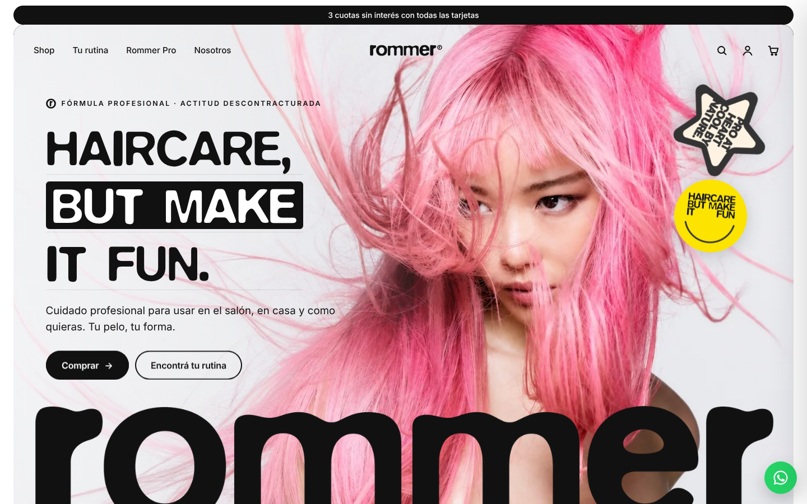

# Rommer: web e-commerce (versión 5)

Vista navegable de la tienda online de **Rommer**, generada desde el tema de WordPress. Es la misma web que se instala en Hostinger, con los cambios pedidos por el cliente.

- `index.html`: Home
- `producto-shampoo-keratin.html` (y el resto de los `producto-….html`): fichas de producto
- `nosotros.html`, `envios.html`, `preguntas-frecuentes.html`, `cambios-y-devoluciones.html`, `contacto.html`, `terminos-y-condiciones.html`, `politica-de-privacidad.html`, `boton-de-arrepentimiento.html`: páginas simples y legales

## Cambios de esta versión
- **Menú:** Shop · Tu rutina · Rommer Pro · Nosotros (también en el celular y en el footer).
- **Portada:** texto nuevo y botón “Encontrá tu rutina”.
- **Franja animada:** Fórmula profesional · Industria argentina · Resultados que se sienten · Para el salón y para vos.
- **Los elegidos de Rommer** (antes “Los más pedidos”).
- **Tu rutina Rommer** (antes “El Método”): “Tu rutina. Tus reglas.”, bajada y los 3 pasos con sus textos nuevos.
- **Fórmulas que se notan:** Alisado → Botox Repair y Nutrición → Thermo Shield Complex (Reparación sigue con Shampoo Keratin).
- **Changuito:** con un cupón guardado se puede escribir otro código (antes solo aparecía “Usar mi cupón”).
- **Haircare for hot girls:** “hot girls” separado, textos nuevos y botón “Sumate a rommer’s club”.
- **Rommer en tu salón:**
  - bajada y beneficios nuevos;
  - dos botones, uno para salones y otro para distribuidores, cada uno con su formulario;
  - los dos formularios llegan por WhatsApp.
- **Popup de bienvenida (nuevo):** a los 6 segundos ofrece 10% OFF en la primera compra a cambio del email. En WordPress crea un cupón único para esa persona y le manda un mail de bienvenida; los emails quedan en Rommer → Suscriptores.
- **Cupón en la tienda (nuevo):** después de suscribirse, cada producto muestra “Usar mi cupón” con el precio con descuento, el changuito muestra el cupón y en WordPress se aplica solo al pagar. Al cerrar el popup queda una pestaña “🎁 10% OFF”; en el celular el popup aparece al bajar.
- **Reglas del cupón (nuevo):** el cupón de bienvenida es solo para la primera compra, de un solo uso y con su email; no se suma con el descuento por kit (se aplica el mayor) y sí con la transferencia.
- **Footer profesional (nuevo):** links legales (Términos, Privacidad, Defensa del consumidor), Botón de arrepentimiento con su formulario y créditos de diseño y desarrollo de ALTO.
- **Producto nuevo: Botox Repair** (tratamiento de reparación intensiva), con su ficha y en el carrusel “Los elegidos de Rommer”.
- **Antes / después:** fotos reales, alineadas (cabeza y hombros en el mismo lugar al mover la línea), con el mismo fondo blanco y sin filtros: se ven en su calidad original.
- **Haircare for hot girls:** la foto se mueve despacio simulando un video. En WordPress se puede cargar un video en su lugar.
- **Botón “Hacé el test”** de Tu rutina: se sacó.
- **Sección “¿Y si lo profesional no tuviera que verse profesional?”:** se sacó de esta vista. En WordPress queda oculta para usarla más adelante.
- **Popup:** un solo cupón por persona. Si vuelve a suscribirse con el mismo mail (o escrito distinto, como ana+1@gmail.com) recibe el mismo código; si ya venció, no se le da otro.
- **Secciones ocultas:** Banners 50/50, ¿Qué necesita tu pelo?, Armá tu kit, Recién salidos y kits, y Manifiesto. No se borraron: en WordPress se vuelven a mostrar desde “Secciones de la Home”.

## Qué es demostración en esta vista
Esta copia no tiene servidor. Por eso:
- “Finalizar compra” muestra un aviso en lugar de abrir el pago.
- La calculadora de envío muestra valores de ejemplo.
- No se pueden dejar reseñas.
- El popup muestra un código de ejemplo (HOLA-7KQ2PM) y no manda mail. En el changuito, “¿Tenés un cupón?” acepta ese código de ejemplo.

En WordPress todo eso funciona con WooCommerce y Mercado Pago.

## Cómo verla
Abrí `index.html` con doble clic, o publicala con GitHub Pages: Settings → Pages → Deploy from a branch → `main` / root.

> Productos, precios y algunas fotos siguen siendo de ejemplo hasta cargar los definitivos.
